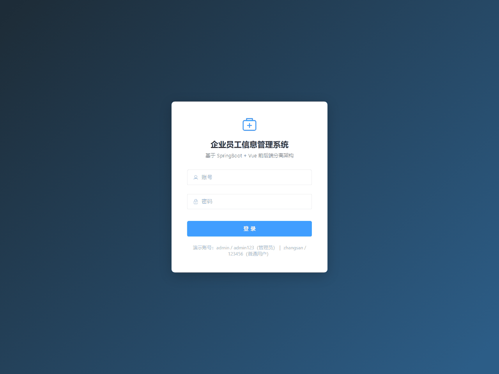

# 企业员工信息管理系统

> 课程设计 · 二次开发（AI 赋能版）｜ SpringBoot + Vue 前后端分离架构 ｜ 求职展示项目

基于 SpringBoot 3.3 + MyBatis + MySQL + Redis 的企业级员工信息管理系统，实现**员工管理、部门管理、权限控制、AI 智能助手**四大核心模块，覆盖完整企业组织管理业务流程。二次开发新增：BCrypt 密码加密、登录失败锁定、Knife4j 接口文档、JUnit5 自动化测试、AI 自然语言查询员工（GLM function calling）。

## 一、技术栈

| 层 | 技术 |
|---|---|
| 后端框架 | Spring Boot 3.3.4（JDK 17） |
| 持久层 | MyBatis 3.0.3 + PageHelper 2.1.0 |
| 数据库 | MySQL 8.x（Druid 连接池） |
| 缓存 | Redis（Spring Data Redis + Lettuce 池） |
| 权限 | 自定义注解 + AOP 切面 + HandlerInterceptor（前后端双重） |
| 安全 | spring-security-crypto（BCrypt 密码哈希 + 登录失败锁定） |
| 接口文档 | Knife4j 4.5.0（springdoc-openapi 3） |
| 测试 | JUnit5 + Spring Boot Test + MockMvc（17 用例全绿） |
| AI | 智谱 GLM-4-Flash（OpenAI 兼容 / function calling）+ RestTemplate |
| 前端 | Vue 3 + Vite 5 + Element Plus + Vue Router + Pinia + Axios |
| 工具 | Maven（本地仓库 D:/maven/repository）、Git、Postman |

## 二、快速启动

### 1. 环境准备

- JDK **17+**（JDK 25 实测可运行；Lombok 需 annotationProcessorPaths 兼容配置）
- MySQL 8.x，本地启动（库 `emp_manage`）
- Redis，本地启动（默认 6379 端口，无密码）
- Node.js 18+（前端）

### 2. 数据库

无需手动建表：Spring Boot 启动时自动执行 `src/main/resources/db/schema.sql`（四张表）和 `data.sql`（种子数据）。`data.sql` 使用幂等 upsert 写入 **BCrypt 密文**，保证已有库也刷新为密文密码。

数据库名固定为 `emp_manage`，连接信息在 `application.yml`：

```yaml
url: jdbc:mysql://localhost:3306/emp_manage?...
username: root
password: 你的MySQL密码   # ← 改成自己的
```

### 3. 启动后端

```bash
# 在项目根目录
mvn spring-boot:run
```

启动成功后可访问：
- Druid 监控台：http://localhost:8080/druid
- **Knife4j 接口文档：http://localhost:8080/doc.html**（OpenAPI 定义：/v3/api-docs）

### 4. 启动前端

```bash
cd frontend
npm install
npm run dev
```

访问 http://localhost:5173 ，Vite 已将 `/api` 代理到后端 8080。

### 6. 敏感配置说明（重要）

MySQL 密码与智谱 AI key **不会入库**（`.gitignore` 已排除 `src/main/resources/application-local.yml`）。本地启动时 `spring.profiles.default: local` 会自动加载本机这份文件：

```yaml
# src/main/resources/application-local.yml（本地创建，模板）
MYSQL_PASSWORD: 你的MySQL密码
ai:
  glm:
    api-key: 你的智谱key
```

不想建文件的话，也可以设置环境变量 `MYSQL_PASSWORD` / `AI_GLM_API_KEY`。未配置 AI key 时，AI 接口会返回友好提示而非报错。

## 系统演示



### 5. 演示账号

| 账号 | 密码 | 角色 | 权限 |
|---|---|---|---|
| admin | admin123 | 管理员 | 全部（增删改查） |
| zhangsan | 123456 | 普通用户 | 只读（emp:view / dept:view） |

密码以 BCrypt 密文存储（`$2a$10$...`，加盐哈希，不可逆）；同一账号连续输错 5 次密码锁定 15 分钟（Redis 计数）。

用 zhangsan 登录时，界面上的新增/编辑/删除按钮自动隐藏，直接调接口也会被 AOP 切面拦下返回 403——**前后端双重权限控制**。

## 三、架构设计

### 3.1 后端分层（Controller - Service - Mapper）

```
com.example.demo3
├── common/            # 统一返回 Result / 分页 PageResult / 全局异常处理 / 错误码
├── config/            # Redis 序列化 / WebMvc 拦截器注册 / BCryptPasswordEncoder / RestTemplate
├── controller/        # EmpController / DeptController / AuthController / PermissionController / AiController
├── service/           # 业务接口 + impl（含 AI 服务与工具执行器 AiToolExecutor）
├── mapper/            # MyBatis 接口
├── entity/            # 实体类（带 jakarta.validation 校验注解）
├── dto/               # EmpQueryDTO / LoginDTO / AiChatDTO
├── annotation/        # @RequirePermission 权限注解
├── aspect/            # PermissionAspect 权限切面
└── interceptor/       # AuthInterceptor 登录态拦截器
```

职责纪律：Controller 只收参数和包装返回；业务校验全部写在 Service；Mapper 只写 SQL。

### 3.2 数据模型（四张核心表）

| 表 | 说明 | 关键设计 |
|---|---|---|
| `dept` | 部门表 | `uk_dept_name` 部门名唯一 |
| `emp` | 员工表 | `dept_id` 外键关联 dept；联合索引 `idx_emp_name_dept(name, dept_id)` 覆盖最高频查询 |
| `permission` | 角色权限表 | `(role, perm_code)` 联合唯一，一角色一权限一行 |
| `sys_user` | 系统用户（角色）表 | 账号唯一索引 + 角色索引；password 列为 BCrypt 密文 |

建表语句见 `resources/db/schema.sql`，含完整注释。

### 3.3 Redis 缓存策略

热点部门数据三级保障：

1. **读**：先查缓存，命中直接返回不打 MySQL；未命中查库后回写，TTL 30 分钟
2. **写**：增/改/删后**主动失效**相关缓存（列表 key + 精确 key），下次读自然回源重建
3. **兜底**：TTL 到期自动过期 + Redis 故障时 try-catch **降级走库**——缓存是加速件，不是单点

缓存键规范：`dept:list`、`dept:{id}`、`perm:role:{role}`、`auth:token:{token}`、`auth:fail:{username}`

### 3.4 权限控制链路

```
请求 → AuthInterceptor（校验登录态 Token → Redis）
     → @RequirePermission 注解 → PermissionAspect 切面（查角色权限码）
     → Controller 业务执行
```

- 登录：`POST /auth/login` 校验账号密码（BCrypt matches）→ 校验通过生成 UUID Token 存 Redis（2 小时滑动过期）
- 失败锁定：同一账号连续失败 5 次，Redis `auth:fail:{username}` 计数达到阈值后锁定 15 分钟（Redis 故障时降级放行，保证系统可用性）
- 防枚举：登录失败统一返回「账号或密码错误」，不区分账号不存在/密码错误
- 鉴权：切面从请求上下文拿用户角色 → 查 `permission` 表（带缓存）→ 不含所需权限码抛 403
- 前端：Pinia 存权限码列表，按钮级 `v-if` 控制，越权操作根本不出现在界面上

### 3.5 AI 智能助手（双通道设计）

```
用户自然语言问题（POST /ai/chat）
        │
        ▼
┌─────────────────────────────────────────────┐
│ 第 1 轮：LLM（GLM-4-Flash）+ tools 声明      │
│   ① 触发 tool_calls（真 function calling）──┼──► 主链路：LLM 决策工具与参数
│   ② 未触发 ──► 规则路由兜底（关键词判断）    │
└─────────────────────────────────────────────┘
        │
        ▼
执行工具（AiToolExecutor → 查真实 MySQL）
   query_emp(department/job/gender)  员工名单
   count_emp_by_dept()               各部门人数
        │
        ▼
工具结果以 role=tool 回填 → LLM 结合真实数据组织中文回答
（最多 3 轮，防死循环）
```

设计要点（面试演示核心）：
1. **真 function calling 主链路**：LLM 决策该调哪个工具、抽取参数（如「研发部的女员工」→ `query_emp(department=研发部, gender=女)`）
2. **规则路由兜底**：免费模型偶发「不触发工具调用」，第一轮未触发时用关键词规则直接确定工具，名单查询的参数仍交给 LLM 二次抽取（`extractQueryArgs`）——保证演示任何问法稳定跑通
3. **防编造**：系统提示强约束「必须先调用工具获取真实数据，禁止编造」，部门不存在时工具返回可读提示（如「部门[技术部]不存在，现有部门：研发部、人事部」）
4. **多轮回填**：assistant 的 `tool_calls` 原样入历史 + `role=tool` 结果回填，符合 OpenAI 协议格式
5. **安全性**：`/ai/**` 也走登录拦截（需 Authorization 头），AI key 仅存于 `application.yml`（本地演示用，不上生产）

## 四、接口文档

统一返回格式：`{"code":200,"msg":"操作成功","data":{...}}`；错误码：400 参数错误 / 401 未登录 / 403 无权限 / 404 不存在 / 500 系统错误。

除登录接口外，所有请求需带请求头：`Authorization: Bearer {token}`

> 在线调试：启动后端后访问 http://localhost:8080/doc.html（Knife4j），全部接口含中文说明与参数示例。

### 认证

| 方法 | 路径 | 说明 | 所需权限 |
|---|---|---|---|
| POST | /auth/login | 登录（BCrypt 校验 + 失败锁定），返回 token + 权限列表 | 无 |
| POST | /auth/logout | 注销，删除 Redis 登录态 | 登录 |
| GET | /auth/me | 当前用户信息 + 权限列表 | 登录 |

### 员工管理

| 方法 | 路径 | 说明 | 所需权限 |
|---|---|---|---|
| GET | /emp/page | **条件分页查询** `?pageNum=1&pageSize=10&name=张&deptId=1&job=工程师&gender=男` | emp:view |
| GET | /emp/list | 查询全部（联查部门名） | emp:view |
| GET | /emp/{id} | 按 id 查询 | emp:view |
| POST | /emp/add | 新增（@Valid 字段校验） | emp:add |
| PUT | /emp/{id} | 修改 | emp:edit |
| DELETE | /emp/{id} | 删除 | emp:delete |
| DELETE | /emp/batch | 批量删除，请求体 `[1,2,3]` | emp:delete |

### 部门管理

| 方法 | 路径 | 说明 | 所需权限 |
|---|---|---|---|
| GET | /dept/list | 查询全部（带员工数，走缓存） | dept:view |
| GET | /dept/{id} | 按 id 查询（走缓存） | dept:view |
| POST | /dept/add | 新增（部门名唯一校验） | dept:add |
| PUT | /dept/{id} | 修改 | dept:edit |
| DELETE | /dept/{id} | 删除（有员工的部门返回业务错误） | dept:delete |

### 权限管理

| 方法 | 路径 | 说明 | 所需权限 |
|---|---|---|---|
| GET | /perm/list?role=admin | 查询角色权限列表 | perm:view |

### AI 智能助手（新增）

| 方法 | 路径 | 说明 | 所需权限 |
|---|---|---|---|
| POST | /ai/chat | 自然语言查员工/统计部门人数，返回 LLM 组织的中文回答 | 登录 |

请求示例：

```json
POST /ai/chat
Authorization: Bearer {token}
{"message": "统计各部门人数"}
```

响应示例：

```json
{"code":200,"msg":"操作成功","data":"研发部有3人，人事部有1人。"}
```

支持的问题类型（工具）：
- `count_emp_by_dept`：「统计各部门人数」「每个部门多少人」
- `query_emp`：「帮我查研发部的女员工」「研发部有哪些员工」（参数：department / job / gender）

### Postman 测试要点

- 参数缺失：`POST /emp/add` 不带 name → 400「员工姓名不能为空」
- 非法值：age 传 10 → 400「年龄必须在18~60之间」；手机号传 123 → 400「手机号格式不正确」
- 权限不足：zhangsan 调 `POST /emp/add` → 403「没有权限执行该操作」
- 未登录：不带 Authorization 头 → 401「未登录，请先登录」
- 业务一致性：删除有员工的部门 → 500「该部门下还有 N 名员工，不能删除」
- 登录失败锁定：同一账号错密 5 次 → 401「账号已锁定，请15分钟后再试」；锁定期正确密码也 401

## 五、工程化实践

- **Maven**：依赖版本统一由 spring-boot-starter-parent 管理；Lombok 显式锁 1.18.48 + annotationProcessorPaths（JDK 25 兼容）；artifactId=`emp-manage`
- **BCrypt**：`spring-security-crypto` 引入 `BCryptPasswordEncoder`（只引加密库，不引全量 Spring Security），登录用 `matches()` 校验，data.sql 幂等刷密文
- **Knife4j**：基于 springdoc-openapi 3，Controller 补全 @Tag/@Operation/@Parameter 中文注解，分页参数用 @ParameterObject 聚合
- **自动化测试**：JUnit5 + MockMvc，连接真实 MySQL/Redis，`@Transactional` 每个用例回滚，覆盖登录/防枚举/锁定/权限 403/员工 CRUD/缓存命中
- **统一结果封装**：所有接口返回 `Result<T>`，前端 axios 拦截器统一解包
- **全局异常处理**：`@RestControllerAdvice` 捕获业务异常、参数校验异常、系统异常，堆栈只进日志不泄露前端
- **SQL 优化**：员工/部门联查用一次 JOIN + resultMap 映射，替代循环单查的 N+1 问题；批量删除用单条 `IN` 语句；PageHelper 物理分页
- **AI 工具协作**：样板代码生成、逻辑梳理用 AI 辅助，核心业务逻辑（缓存策略、权限链路、异常体系、双通道兜底）人工设计与把控
- **前端 AI 对话页**：侧边栏新增「AI 智能助手」入口（Vue3 + Element Plus 对话式界面），支持快捷示例问题与 Enter 发送；AI 接口单独 60s 超时（多轮 LLM 调用比普通接口慢）

## 六、目录结构

```
demo3/
├── pom.xml                        # Maven 配置（artifactId=emp-manage）
├── src/main/
│   ├── java/com/example/demo3/    # 后端源码（见 3.1）
│   └── resources/
│       ├── application.yml        # 数据源/Redis/分页/SQL初始化/springdoc/ai.glm(key,base-url,model)
│       ├── db/schema.sql          # 四张核心表 + 索引 + 外键（password 注释标 BCrypt）
│       ├── db/data.sql            # 种子数据（BCrypt 密文，幂等 upsert）
│       └── mapper/                # MyBatis XML（EmpMapper/DeptMapper/SysUserMapper）
├── src/test/java/com/example/demo3/   # JUnit5 测试（Auth 6 / Dept 3 / Emp 8）
└── frontend/                      # Vue3 前端工程
    ├── src/views/                 # Login / EmpList / DeptList / PermList
    ├── src/api/                   # axios 封装 + 各模块接口
    ├── src/store/user.js          # Pinia 用户状态（token/权限码）
    └── src/router/                # 路由 + 登录守卫
```

## 七、本地验证记录

以下链路已在本机（真实 MySQL 连接 + 真实 Redis）完整跑通：

### 7.1 原 13 项链路回归（二次开发后全部通过）

| # | 验证项 | 结果 |
|---|---|---|
| 1 | 应用启动（Bean 装配 / MyBatis 扫描 / AOP / 拦截器） | ✅ 3~4s 启动，Tomcat 就绪 |
| 2 | 登录（admin/admin123，BCrypt）→ 签发 Token 存 Redis | ✅ |
| 3 | 条件分页查询 `?pageNum=1&pageSize=3` | ✅ total/pages 正确，JOIN 联查 deptName |
| 4 | 部门列表联查员工数 | ✅ 子查询统计正确 |
| 5 | **缓存命中**：连续两次 /dept/list | ✅ 首次查库，后两次「缓存命中」零 SQL |
| 6 | **缓存联动失效**：新增员工后再查部门 | ✅ 研发部人数刷新，DEL dept:list 实证 |
| 7 | 新增员工 + 部门存在性校验 | ✅「所选部门不存在」人话错误 |
| 8 | 批量删除（单条 IN 语句） | ✅ |
| 9 | zhangsan 越权访问 /perm/list、POST /emp/add | ✅ 403「没有权限执行该操作」 |
| 10 | zhangsan 正常访问 /emp/page（有 view 权限） | ✅ 200 |
| 11 | 非法参数 age=10 | ✅ 400「年龄必须在18~60之间」 |
| 12 | 注销后原 Token 再访问 | ✅ 401「登录已过期」 |
| 13 | 无 Token 访问业务接口 | ✅ 401「未登录，请先登录」 |

### 7.2 二次开发新增验证（P0 + P2①）

| # | 验证项 | 结果 |
|---|---|---|
| 14 | **BCrypt 登录**：admin/admin123、zhangsan/123456 均 matches 通过；错密码返回「账号或密码错误」 | ✅ |
| 15 | **登录锁定**：错密×5 → Redis `auth:fail:{username}`=5 → 第 6 次正确密码仍 401「账号已锁定」→ 清除计数后恢复 | ✅ |
| 16 | **Knife4j 文档**：doc.html 200；/v3/api-docs 完整 OpenAPI（含 /auth/login、/emp/page、/dept/list、/perm/list、/emp/add、/ai/chat 等全部路径） | ✅ |
| 17 | **自动化测试**：`mvn test` → AuthControllerTest 6 + DeptControllerTest 3 + EmpControllerTest 8，**17/17 全绿**（事务回滚，不污染数据） | ✅ |
| 18 | **AI 助手-统计**：「统计各部门人数」→ 第 1 轮 LLM 决策 `count_emp_by_dept` → 回复「研发部有3人，人事部有1人」 | ✅ |
| 19 | **AI 助手-条件查询**：「帮我查研发部的女员工」→ 第 1 轮 LLM 决策 `query_emp(department=研发部, gender=女)` → 回复「研发部的女员工有张三」 | ✅ |
| 20 | **AI 助手-兜底**：第一轮偶发不触发时，规则路由兜底执行工具，结果仍回填 LLM 组织回答（链路不断） | ✅ |
| 21 | **AI 助手-防编造**：查询不存在的部门 → 返回「部门不存在，现有部门：研发部、人事部」，不编造数据 | ✅ |

## 八、已知限制

- **AI key 仅本地演示**：智谱 GLM key 写在 application.yml，生产环境应迁移到环境变量/密钥管理，并对 LLM 输出做内容安全过滤与调用配额控制
- **免费模型能力边界**：GLM-4-Flash 的 function calling 偶发「不触发工具/参数略偏差」，项目用规则路由兜底 + 重问缓解；极少数场景 LLM 总结会合并同名员工（如两名「张三」），数据本身以工具返回为准
- **无注册/找回密码**：账号由管理员在数据库预置（密码为 BCrypt 密文）
- **权限粒度到「角色 + 权限码」**：更细可扩展到数据行级权限
- **AI 为同步调用**：单次问答约 2~5 秒，生产可改流式（SSE）提升体验

## 九、界面展示


